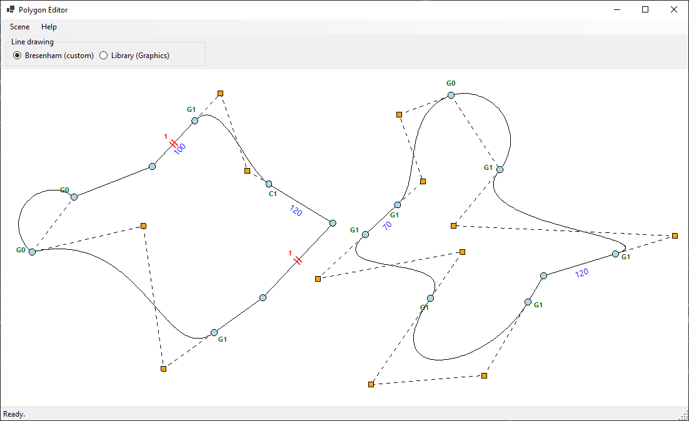
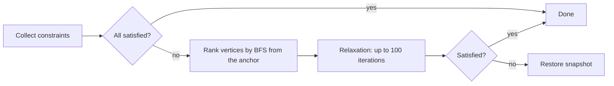

<div align="center">

# Polygon Editor

**Interactive editor for polygons and curved polygons with geometric constraints**

[](https://dotnet.microsoft.com/)
[](https://learn.microsoft.com/dotnet/csharp/)
[](https://learn.microsoft.com/dotnet/desktop/winforms/)
[](LICENSE)



</div>

## Overview

Polygon Editor lets you build and reshape polygons whose edges can be **straight segments**, **cubic Bézier curves** or **circular arcs**. You can attach **constraints** to edges (fixed length, parallel edges) and require **G0 / G1 / C1 continuity** at vertices. An iterative solver keeps all of them satisfied in real time while you drag vertices, control points or whole polygons.

All rasterization is hand-written: **Bresenham's line algorithm** for segments and **incremental algorithms** for curves (forward differences for Bézier curves, fixed-angle rotation for arcs).

> Created as a project for the *Computer Graphics 1* course at the Faculty of Mathematics and Information Science (MiNI), Warsaw University of Technology (WUT).

## Contents

- [Features](#features)
- [Getting started](#getting-started)
- [Usage](#usage)
- [How it works](#how-it-works)
- [Project structure](#project-structure)
- [Assumptions and limitations](#assumptions-and-limitations)
- [License](#license)

## Features

| Area | What you get |
|---|---|
| **Scene** | Multiple polygons on one canvas, self-intersections allowed |
| **Editing** | Drag vertices, Bézier control points or whole polygons; insert a vertex at an edge midpoint; remove a vertex |
| **Edge types** | Line segment · cubic Bézier curve with draggable control points · circular arc (half circle or tangent to its neighbour) |
| **Constraints** | Fixed edge length · parallel edges (also across polygons), shown as icons on the canvas |
| **Continuity** | G0, G1 and C1 at vertices next to curves (G0 and G1 for arcs); G1 by default next to a Bézier curve |
| **Solver** | Iterative relaxation anchored at the edited element; operations that cannot be satisfied are rolled back |
| **Rendering** | Custom Bresenham or library `Graphics.DrawLine`, switchable at runtime |
| **Help** | Built-in help window (<kbd>F1</kbd>) describing usage, assumptions, data model and algorithms (in Polish) |

## Getting started

### Requirements

- Windows 10 or newer
- [.NET 10 SDK](https://dotnet.microsoft.com/download)

### Run

```bash
git clone https://github.com/m00fi/polygon-editor.git
```

```bash
cd polygon-editor
```

```bash
dotnet run --project PolygonEditor
```

Alternatively, open `PolygonEditor/PolygonEditor.slnx` in Visual Studio and press <kbd>F5</kbd>.

The app starts with a demo scene of two polygons that uses every edge type, constraint and continuity kind.

## Usage

### Mouse and keyboard

| Input | Action |
|---|---|
| Left drag on a vertex | Move the vertex (if the constraints cannot follow, the whole polygon moves) |
| Left drag on a control point | Move a Bézier control point |
| Left drag inside a polygon | Move the whole polygon |
| Right click on an edge | Edge menu: add vertex, length / parallel constraints, edge type |
| Right click on a vertex | Vertex menu: remove vertex, continuity G0 / G1 / C1 |
| <kbd>Esc</kbd> | Cancel picking the second edge of a parallel constraint |
| <kbd>Ctrl</kbd> + <kbd>R</kbd> | Reset to the demo scene |
| <kbd>F1</kbd> | Open the help window |

### Canvas legend

| Marker | Meaning |
|---|---|
| Blue number | Fixed edge length |
| Two red ticks with a number | Parallel pair (same number on both edges) |
| Green `G0` / `G1` / `C1` | Continuity at a vertex |
| Orange square | Bézier control point |
| Dashed line | Bézier control polygon or arc chord |

## How it works

### Data model

```
Scene
├── Polygons          : List<Polygon>
└── Constraints       : ConstraintStore   user constraints (length, parallel)

Polygon
├── Vertices          : List<Vertex>
└── Edges             : List<Edge>        Edges[i] goes from Vertices[i] to Vertices[(i+1) mod n]

Vertex
├── Position          : PointF
├── Continuity        : G0 / G1 / C1
└── Incoming, Outgoing: Edge

Edge
├── Start, End        : Vertex
├── Kind              : Line / CubicBezier / CircularArc
├── Control1, Control2: ControlPoint      Bézier only
└── ArcSide           : float             side the half circle bends to

ControlPoint
├── Owner             : Vertex
└── Offset            : PointF            Position = Owner.Position + Offset
```

- **Two-way topology**: a vertex knows its incoming and outgoing edge, and an edge knows its ends, so constraints reach their neighbours without searching.
- **Control points move with their vertex**: they are stored as an offset, so every vertex move (including one made by the solver) keeps the curve's shape near that vertex.
- **Arcs store no geometry**: the circle is recomputed from the end points and the neighbour's tangent whenever it is needed, so it can never get out of sync.

### Constraint solver



1. **Collect** the user constraints plus continuity constraints generated from vertex settings, so continuity state lives in one place only.
2. **Rank** every vertex by its BFS distance from the **anchor**, the element being dragged or edited. The anchor has rank 0 and never moves.
3. **Relax**: each constraint corrects the vertex with the higher rank, so corrections spread outwards from the anchor instead of fighting each other.
4. **Roll back** on failure using a snapshot of positions, control points, continuity and constraints. A dragged vertex is the exception: the whole polygon is translated so the vertex still follows the cursor.

| Constraint | Tolerance |
|---|---|
| Length | ±0.5 px |
| Parallel, G1 | \|sin(angle)\| ≤ 0.005 (about 0.3°) |
| C1 | handle position ±0.5 px |

### Continuity

| Level | Condition | Handles |
|---|---|---|
| **G0** | Edges meet at the vertex | Free |
| **G1** | Incoming and outgoing tangents point the same way | Collinear with the vertex, any lengths |
| **C1** | G1 plus equal derivative vectors | Collinear and matching lengths |

The derivative at a Bézier end is $3 \times$ its handle, while a line's derivative is the segment itself. With C1 next to a line, the handle is therefore $1/3$ of the line's length.

### Circular arcs

A circle passing through both edge ends has exactly **one degree of freedom left**, which defines the rules:

- **G0 at both ends**: a half circle over the chord, bending outwards.
- **G1 at one end**: the arc is tangent to the neighbouring edge. With start point $P$, tangent normal $n$ and chord $d$, the center is

  $$C = P + \lambda n, \qquad \lambda = \frac{|d|^2}{2\, n \cdot d}$$

  The end variant reuses the same formula on the reversed arc. If the tangent is parallel to the chord, the arc falls back to a half circle.
- **G1 at both ends and C1 are not allowed**, because the circle is already fully determined.

### Rasterization

| Primitive | Algorithm |
|---|---|
| Line | Integer Bresenham for all octants with a single shared error term |
| Bézier curve | Power basis $a t^3 + b t^2 + c t + d$ evaluated with **forward differences**: additions only inside the loop |
| Arc | Radius vector rotated by a fixed angle each step; `cos` and `sin` computed once |

Curves and arcs are sampled about every 4 px (8 to 1000 points). The same point list is used for drawing and for hit testing.

### Hit testing

- Distance thresholds: vertex 8 px, control point 7 px, edge 10 px.
- Polygon interior: ray casting with the even-odd rule, on an outline that includes curves and arcs.

## Project structure

```
PolygonEditor/
├── Models/        scene, polygons, vertices, edges, control points, arc geometry, snapshot
├── Constraints/   constraint interface, length / parallel / continuity constraints, solver
├── Drawing/       renderer, Bresenham, incremental Bézier and arc, edge shapes
├── Interaction/   mouse hit testing
├── Scene/         demo scene factory
└── UI/            main window, canvas, context menus, help window
```

## Assumptions and limitations

- Length and parallel constraints apply to straight segments only; changing an edge to a curve or arc removes them.
- Adjacent edges (sharing a vertex) cannot be made parallel.
- Inserting a vertex splits the edge into two segments; removing a vertex merges its two edges into one segment.
- A polygon always keeps at least 3 vertices. New polygons are created in code (`DemoSceneFactory`).
- "Outwards" for new curves is taken from the sign of the polygon's area, which is only an approximation for self-intersecting polygons.

## License

Distributed under the [MIT License](LICENSE).

Copyright © 2026 Michał Chrostowski
